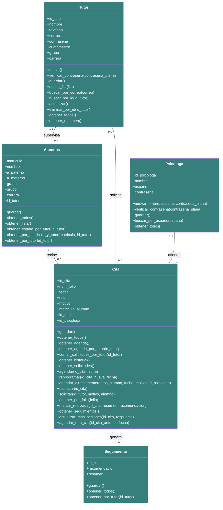

# Diagrama de clases UML - Agenda Psico UTE

El siguiente diagrama representa las clases, atributos, métodos y relaciones implementados en los modelos de Python del sistema.

## Descripción de las clases

- **Alumnos:** administra el registro y la consulta de los estudiantes.
- **Tutor:** administra los tutores, sus datos y su autenticación.
- **Psicologa:** administra la autenticación y los datos de la psicóloga.
- **Cita:** controla las solicitudes, el agendamiento, la reprogramación, los folios y los cambios de estado.
- **Seguimiento:** administra los resúmenes y las recomendaciones de las sesiones.

## Consideraciones

- Las contraseñas se almacenan mediante hash.
- El teléfono del tutor es opcional.
- Un alumno puede estar registrado sin tener un tutor asignado.
- La ubicación se administra desde la base de datos y no cuenta con una clase independiente en Python.