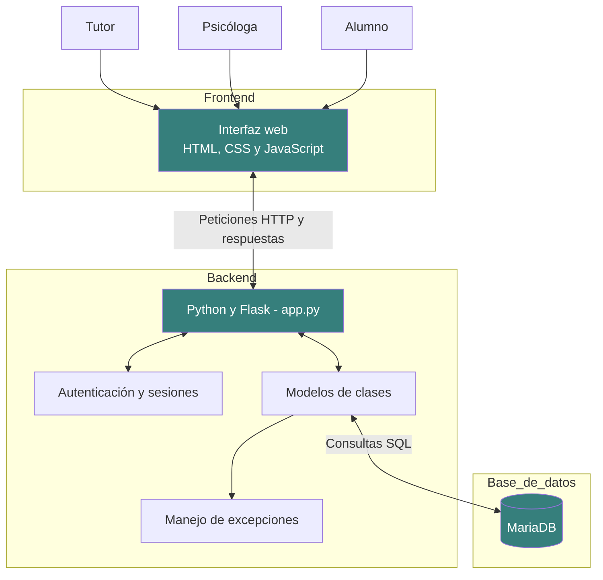

# Diagrama de integración - Agenda Psico UTE

Este diagrama muestra cómo se comunican los usuarios, la interfaz web, el backend y la base de datos del sistema.

## Funcionamiento de la integración

- Frontend: muestra las pantallas y recibe las acciones de los usuarios.
- Backend: procesa las solicitudes, valida los datos y controla los permisos.
- Modelos: organizan la lógica del sistema mediante programación orientada a objetos.
- Base de datos: almacena alumnos, tutores, psicólogas, citas, seguimientos y ubicaciones.
- Manejo de excepciones: permite controlar errores durante las operaciones del sistema.